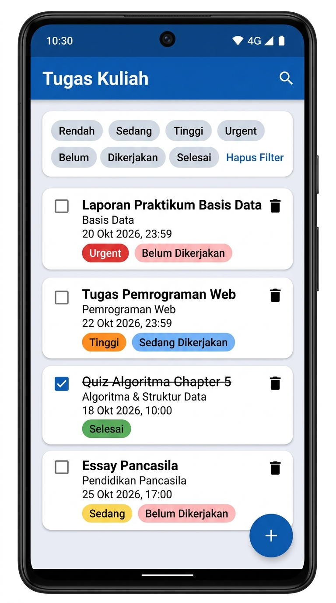
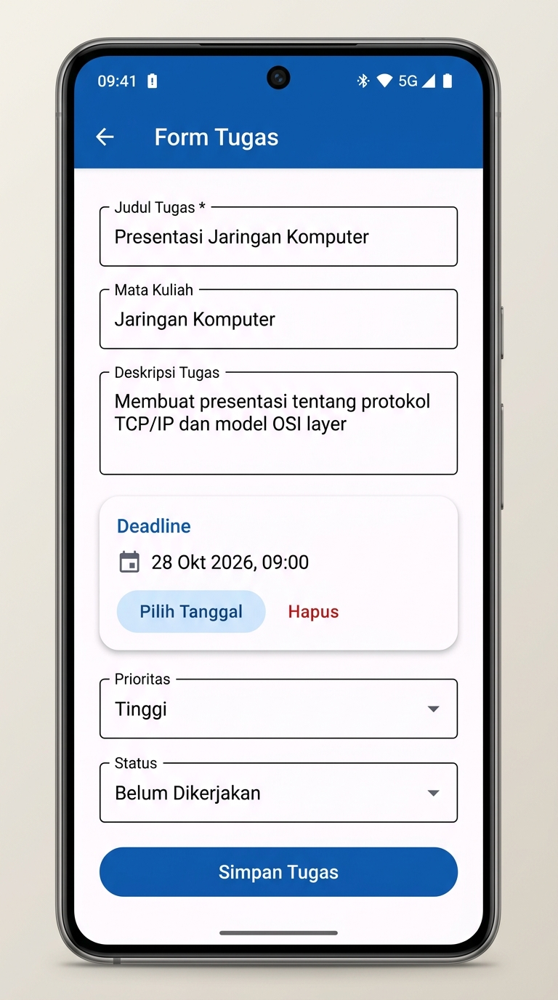

# 📚 Task Manager — Aplikasi Manajemen Tugas Kuliah

<p align="center">
  
  &nbsp;&nbsp;&nbsp;
  
</p>

Aplikasi Android berbasis **Kotlin** untuk membantu mahasiswa mengelola tugas-tugas kuliah secara efisien. Data disimpan secara lokal menggunakan **Room Database** sehingga tetap tersedia tanpa koneksi internet.

---

## ✨ Fitur Utama

- ➕ **Menambah tugas baru** — Isi judul, deskripsi, mata kuliah, deadline, prioritas, dan status
- ✏️ **Mengedit tugas** — Perbarui informasi tugas kapan saja
- 🗑️ **Menghapus tugas** — Konfirmasi dialog sebelum penghapusan
- 📋 **Melihat detail tugas** — Informasi lengkap termasuk tanggal dibuat & terakhir diubah
- ⏰ **Mengatur deadline** — Date & Time Picker dengan deteksi tugas yang melewati deadline (overdue)
- 🎯 **Mengatur prioritas** — 4 level: Rendah, Sedang, Tinggi, Urgent (dengan kode warna)
- 📊 **Mengatur status** — Belum Dikerjakan, Sedang Dikerjakan, Selesai
- 🔍 **Mencari tugas** — Pencarian berdasarkan judul, deskripsi, atau mata kuliah
- 🏷️ **Filter tugas** — Filter menggunakan Chip berdasarkan prioritas dan/atau status
- 💾 **Penyimpanan lokal** — Room Database (SQLite) untuk persistensi data offline

---

## 🛠️ Tech Stack

| Komponen | Teknologi |
|---|---|
| Bahasa | Kotlin 1.9 |
| Arsitektur | MVVM (Model-View-ViewModel) |
| Database | Room 2.6.1 |
| Navigasi | Navigation Component + Safe Args |
| UI Framework | Material Design 3 |
| Async | Kotlin Coroutines + Flow |
| View Binding | ViewBinding |
| Build System | Gradle (Kotlin DSL) |

---

## 🏗️ Arsitektur Aplikasi

Aplikasi ini menggunakan arsitektur **MVVM** dengan pemisahan layer yang jelas:

```
┌─────────────────────────────────────────────┐
│                  UI Layer                    │
│  Fragment ←→ ViewModel                      │
│  (TaskList, TaskDetail, TaskForm)            │
├─────────────────────────────────────────────┤
│              Repository Layer                │
│  TaskRepository (Single Source of Truth)     │
├─────────────────────────────────────────────┤
│               Data Layer                     │
│  Room Database ←→ TaskDao ←→ SQLite         │
└─────────────────────────────────────────────┘
```

---

## 📁 Struktur Proyek

```
app/src/main/
├── java/com/taskmanager/
│   ├── TaskManagerApp.kt              # Application class
│   ├── data/
│   │   ├── model/Task.kt             # Entity + Enums
│   │   ├── database/
│   │   │   ├── Converters.kt         # Room TypeConverters
│   │   │   ├── TaskDao.kt            # Data Access Object
│   │   │   └── TaskDatabase.kt       # Room Database
│   │   └── repository/
│   │       └── TaskRepository.kt     # Repository
│   └── ui/
│       ├── MainActivity.kt           # Host Activity
│       ├── list/                      # Layar daftar tugas
│       ├── detail/                    # Layar detail tugas
│       └── form/                      # Layar form tambah/edit
└── res/
    ├── layout/                        # XML layouts
    ├── navigation/nav_graph.xml       # Navigation graph
    ├── menu/                          # Menu items
    └── values/                        # Colors, strings, themes
```

---

## 🚀 Cara Instalasi & Menjalankan

### Prasyarat
- Android Studio Hedgehog (2023.1.1) atau lebih baru
- JDK 17
- Android SDK 34

### Langkah-langkah
1. Clone repository ini:
   ```bash
   git clone https://github.com/dewinofittasari/task-manager-kuliah.git
   ```
2. Buka proyek di Android Studio
3. Tunggu proses Gradle Sync selesai
4. Jalankan aplikasi di emulator atau perangkat fisik (min. Android 8.0 / API 26)

---

## 📸 Screenshots

| Daftar Tugas | Form Tambah Tugas |
|:---:|:---:|
|  |  |

---

## 💭 Refleksi Pengembangan

### Apa yang Dipelajari

Dalam pengembangan aplikasi Task Manager ini, saya mempelajari beberapa konsep penting dalam pengembangan Android modern:

1. **Arsitektur MVVM** — Memisahkan logika bisnis dari UI membuat kode lebih terstruktur, mudah diuji, dan mudah di-maintain. ViewModel bertanggung jawab mengelola state, sementara Fragment hanya fokus pada rendering UI.

2. **Room Database** — Menggunakan Room sebagai abstraksi di atas SQLite sangat mempermudah operasi database. Dengan anotasi seperti `@Entity`, `@Dao`, dan `@Query`, proses CRUD menjadi lebih deklaratif dan type-safe.

3. **Kotlin Coroutines & Flow** — Memanfaatkan `Flow` untuk reactive data streaming dari database ke UI. Setiap perubahan data di database secara otomatis memperbarui tampilan tanpa perlu polling manual.

4. **Navigation Component** — Mengelola navigasi antar fragment menjadi lebih terorganisir dengan navigation graph. Safe Args memastikan argumen navigasi bersifat type-safe.

5. **Material Design 3** — Menerapkan komponen UI modern seperti `MaterialCardView`, `Chip`, `FloatingActionButton`, dan `TextInputLayout` untuk pengalaman pengguna yang konsisten dan profesional.

### Tantangan yang Dihadapi

- **Type Converters** — Room tidak mendukung tipe data kompleks secara native. Perlu membuat `TypeConverter` khusus untuk tipe `Date` dan `Enum` agar bisa disimpan sebagai tipe primitif di SQLite.
- **Reactive Filtering** — Menggabungkan pencarian dan filter secara bersamaan menggunakan `combine` dan `flatMapLatest` pada Flow cukup menantang, namun menghasilkan UX yang responsif.
- **State Management** — Memastikan data tetap konsisten saat navigasi antar fragment dan saat konfigurasi berubah (rotasi layar) memerlukan pemahaman mendalam tentang lifecycle Android.

### Pengembangan Selanjutnya

Beberapa fitur yang dapat ditambahkan di masa depan:
- 🔔 Notifikasi pengingat sebelum deadline
- 📤 Export/import data tugas
- 🌙 Dark mode support
- 📊 Dashboard statistik tugas
- ☁️ Sinkronisasi cloud (Firebase)

---

## 📄 Lisensi

Proyek ini dibuat untuk keperluan akademik.

---

<p align="center">
  Dibuat dengan ❤️ menggunakan Kotlin & Android Studio
</p>
